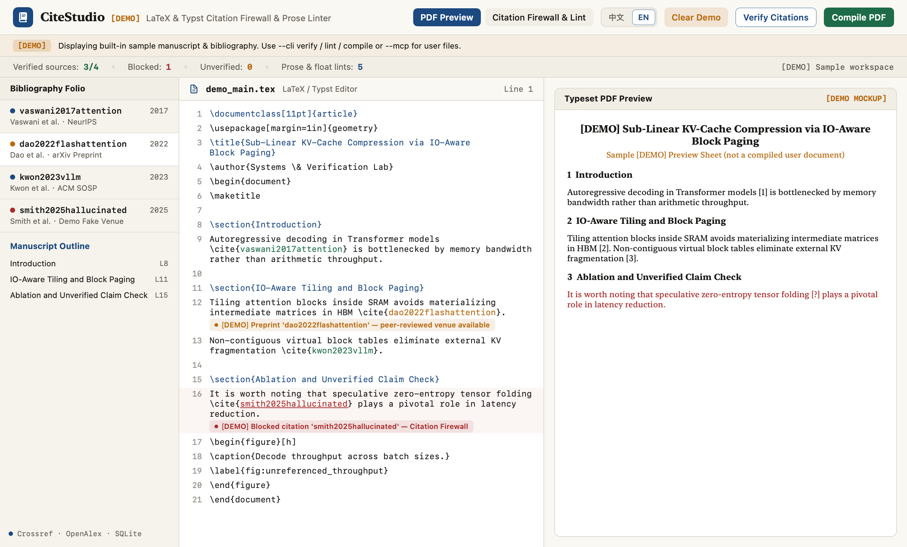
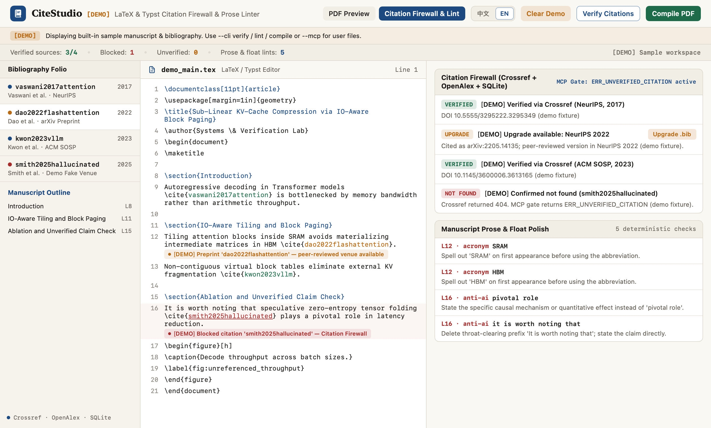
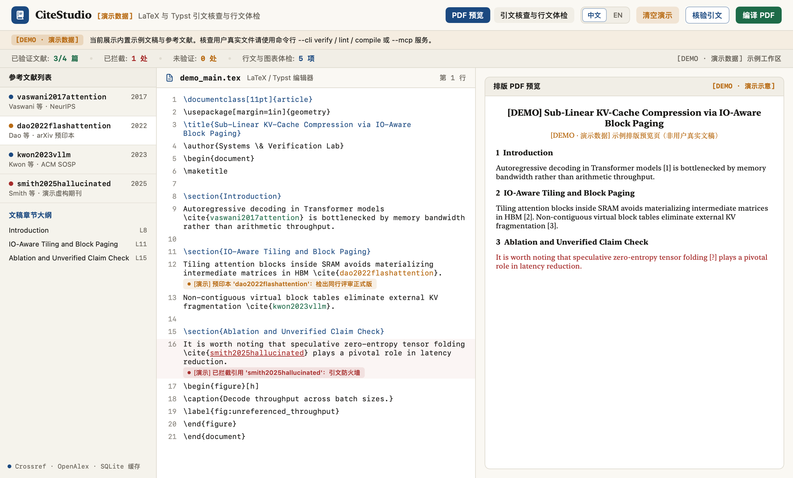
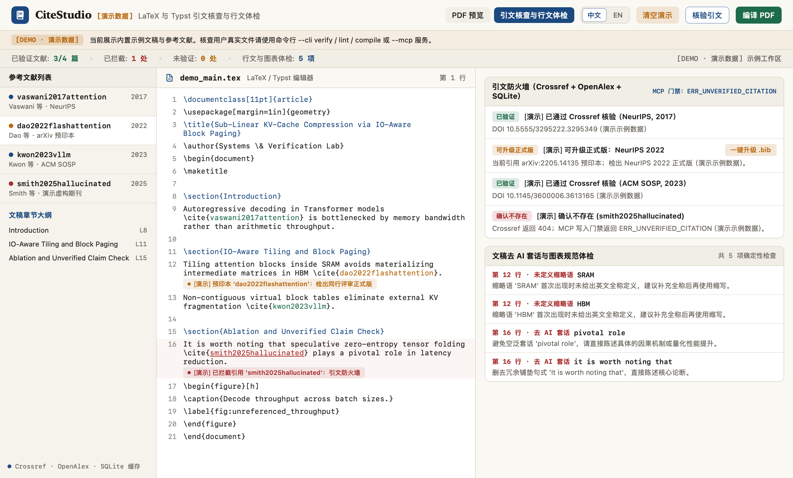

# CiteStudio

**English** | **[简体中文](README.zh-CN.md)**

**Citation Verification, Retraction Check & Prose Linter for LaTeX and Typst on macOS (Swift 6 + Crossref + OpenAlex + MCP)**

> **Version & Scope Notice (Read First)**
> - **Published `v0.2.0` vs. `v0.3.0` onward**: Published `v0.2.0` includes `--cli status`, `--cli lint`, `--cli compile`, `--mcp`, and `--lang en|zh`. Entry points and behaviors marked **since `v0.3.0`** below — including `--cli verify`, `--cli clear-cache`, `--cli help` / `--help`, `--cache-dir`, `--demo`, the empty-by-default desktop workspace, and three-way `Unverified` vs. `GhostPaper` separation — are first available in `v0.3.0`; `v0.2.0` does not have them.
> - **Real user files work via CLI & MCP**: Verify `.bib` bibliographies (`--cli verify`, since v0.3.0), clear cached lookups (`--cli clear-cache`, since v0.3.0), lint `.tex`/`.typ` prose (`--cli lint`), compile documents (`--cli compile`), and gate agent edits via the stdio MCP server (`--mcp`).
> - **Desktop GUI current limits**: Launching `CiteStudio` without `--demo` (since v0.3.0; published `v0.2.0` loaded sample data on launch) starts in a clean **empty workspace** (`0` manuscript text, `0` bibliography entries, `0` diagnostics). Opening arbitrary local project folders in the GUI, bidirectional SyncTeX click-jumping in the GUI, and automatic `pdfs/` bounding-box highlighting in the GUI are **planned and not yet implemented** (see [Planned (Not Yet Implemented)](#planned-not-yet-implemented)). Use the **`Load Demo`** toolbar button or `--demo` flag to inspect the built-in `[DEMO]` sample workspace.

---

## Screenshots (`[DEMO]` Built-in Sample Workspace)

> **Screenshot Notice (`[DEMO]`)**: The screenshots below were rendered from `CiteStudio --demo` (`--export-screenshots`) using built-in sample manuscript and bibliography fixtures labeled **`[DEMO]`**, not an opened user project directory.

### English (`--lang en` · `[DEMO]`)

| Three-Pane `[DEMO]` Sample Preview | Citation Firewall & Prose Lint Drawer (`[DEMO]`) |
| :---: | :---: |
|  |  |
| *`[DEMO]` Built-in sample workspace (`Load Demo` / `--demo`).* | *`[DEMO]` Sample citation statuses and deterministic prose lint cards.* |

### 简体中文 (`--lang zh` · `[DEMO · 演示数据]`)

| 三栏示例工作区（`[DEMO · 演示数据]`） | 引文防火墙与去 AI 套话体检抽屉（`[DEMO · 演示数据]`） |
| :---: | :---: |
|  |  |
| *`[DEMO · 演示数据]` 内置示例工作区（点击“载入演示”或传入 `--demo`）。* | *`[DEMO · 演示数据]` 示例文献核验状态与确定性行文体检卡片。* |

---

## Capabilities (`since v0.3.0` unless noted)

### 1. Citation Verification & Three-Way Lookup Separation (`ScholarTriangulator` — since v0.3.0)
Queries **Crossref** and **OpenAlex** over `URLSession` and separates three upstream outcomes:

1. **Found (`Verified` / `PreprintUpgrade` / `MetadataMismatch` / `Retracted`)**:
   - **DOI verification**: Resolves the DOI (consulting OpenAlex if Crossref returns HTTP `404`, e.g., for DataCite / arXiv `10.48550/...` DOIs) and checks **normalized title similarity** (Jaccard token similarity `>= 0.60`), **diacritic-folded first-author surname**, and **publication year** (`|Δyear| <= 1`). A real DOI paired with a mismatched title, author, or year is flagged as **`MetadataMismatch`**.
   - **Retraction detection**: Checks Crossref `update-to` and `updated-by` notices whose `type` or `label` contains `retract` or `withdraw`, Crossref `relation.is-retracted-by`, `"RETRACTED:"` / `"WITHDRAWN:"` title prefixes, and OpenAlex `is_retracted == true`.
   - **Preprint upgrade hint**: When a cited `arXiv` / `bioRxiv` / `medRxiv` entry matches an upstream peer-reviewed venue, surfaces **`PreprintUpgrade`** with formatted BibTeX.
2. **Confirmed Not Found (`GhostPaper`)**:
   - Reported **only** when **both** Crossref and OpenAlex explicitly return HTTP `404` (not found) for a queried DOI, or when an entry lacks a DOI and both Crossref and OpenAlex top-3 title queries complete with HTTP `200` without any candidate matching normalized title similarity (`>= 0.78`), publication year (`|Δyear| <= 1`), normalized first-author surname, and non-`book-review` work type (`C5`). For DOI-less entries, the diagnostic headline states `"Not found in Crossref / OpenAlex"` rather than claiming the work is fabricated; in `--cli verify --json` and MCP (`verify_citation` and `add_verified_bibtex` rejection payloads), `verdict` remains `"GhostPaper"` and `notFoundReason` reports `"doi_not_found_in_crossref_and_openalex"` (input has a DOI and both Crossref and OpenAlex return HTTP `404`) or `"no_doi_not_found_in_crossref_or_openalex"` (input has no DOI and title search finds no match; see **Current Limitations** below).
   - **Recorded `C5` evidence vs. synthetic unit-test scope**: Verbatim recorded HTTP replay in `Tests/Fixtures/recorded/` (`28` total upstream responses, including **`6` unique DOI-less title searches / `12` title-search responses**) covers **`8` DOI-less BibTeX cases**: an indexed real monograph (`Introduction to Information Retrieval`, Manning et al. 2008, skipping a `book-review` record at `OpenAlex[0]` to match the `book` record at `OpenAlex[1]` -> `Verified`), the same book with `|Δyear| >= 2` (`2003` -> `GhostPaper`), the same book with another author (`Kleinberg` -> `GhostPaper`), a 1-word-modified near-threshold fabricated title (`Distinctive Image Features from Scale-Invariant Matching`, Lowe 2004, Jaccard `0.75` in `(0.50, 0.78)` -> `GhostPaper`, plus recorded HTTP boundary checks at `0.60` and `0.80`), a Chinese-title real paper (*水稻的雄性不孕性*, 袁隆平 1966 -> `GhostPaper`), a 1-word common title (*Algorithms*, Sedgewick & Wayne 2011 -> `GhostPaper`), an unindexed classic monograph (`real_nodoi`, Knuth 1968 -> `GhostPaper`), and a completely invented title (`fake_nodoi` -> `GhostPaper`). Isolated unit branches for surname-normalization variants (LaTeX diacritics, nobiliary particles like `van`, generational suffixes like `Jr.`, and substring non-matches like `Lee` vs. `Greenlee`), `"Book Review:"` title-prefix-only rejection when upstream `type != "book-review"`, and `|Δyear| == 1` on a non-review monograph still rely on **synthetic** handwritten samples (`SyntheticC5TitleCandidateTests.swift` and `m1-acceptance.sh` Part B, excluded from `C5` evidence).
3. **Lookup Failed (`Unverified`)**:
   - Offline networks, DNS/socket failures, request timeouts, HTTP `429` rate limits, HTTP `5xx` upstream errors, or malformed JSON responses — including cases where one registry returns `404` while the second registry fails — are reported as **`Unverified` (`未验证`)**.
   - **`Unverified` results are never written to the SQLite cache** and are never conflated with `GhostPaper`. Once connectivity recovers, subsequent runs re-query upstream immediately.
   - Cached entries carry explicit TTL timestamps (`7 days` for found records; `24 hours` for confirmed-not-found records), and expired entries are evicted automatically on read or purged manually via `--cli clear-cache`.

> **Current Limitations**:
> - **`notFoundReason` only reflects whether the input has a DOI**: In `--cli verify --json` and MCP (`verify_citation` and `add_verified_bibtex`), `notFoundReason` takes `"doi_not_found_in_crossref_and_openalex"` or `"no_doi_not_found_in_crossref_or_openalex"`: `notFoundReason` only reflects whether the input has a DOI (has a DOI and is not found in both registries / has no DOI and is not found). A real book not indexed by Crossref and OpenAlex and a fabricated reference receive the same value, and the product has no basis to distinguish between these two cases.
> - **Pre-DOI monographs not indexed & short high-frequency titles crowded out of top-3**: Crossref and OpenAlex primarily index journal and conference works rather than pre-DOI monographs, dissertations, or technical reports, and title search only inspects the top `3` results (`per-page=3` / `rows=3`). When a classic book without a DOI (such as Knuth 1968 *The Art of Computer Programming*) is absent from Crossref/OpenAlex top-3 results — or when upstream only returns book reviews by other authors (`Odeh` 1969, `MacLaren` 1969, `Wells` 1973), or when a DOI-less work has a 1–2 word common title (such as Sedgewick & Wayne 2011 *Algorithms*) whose top-3 results are occupied by unrelated works — `C5` candidate filtering rejects those non-matching candidates so the entry is reported as not found in Crossref/OpenAlex (`GhostPaper` / `NOT FOUND`) rather than `MetadataMismatch`, and it cannot be auto-verified without external monograph registries (e.g., Open Library).
> - **Chinese / CJK unspaced author names and unsegmented CJK titles**: `normalizedAuthorSurname` splits only on commas and whitespace, and `normalizedTitleSimilarity` splits on non-alphanumeric characters without CJK word segmentation. When Crossref/OpenAlex store a Chinese author as space-separated `"隆平 袁"` (normalized surname `"袁"`, as in the recorded 1966 paper *水稻的雄性不孕性*) or in Latin Pinyin while the `.bib` entry writes an unspaced Chinese full name (`author = {袁隆平}`, normalized as `"袁隆平"`), surname comparison does not match and the DOI-less entry is judged `GhostPaper` (`NOT FOUND`); unpunctuated Chinese titles also form a single token requiring an exact character match.
> - **Untagged book reviews treated as the original book when cited under the reviewer's name**: Many journal book reviews are indexed upstream as generic `article` (OpenAlex) or `journal-article` (Crossref) without a `"Book Review:"` title prefix (for example, Robert E. Odeh's 1969 review of *The Art of Computer Programming* in *Journal of the American Statistical Association*, where OpenAlex reports `"type": "article"`). Type and prefix checks cannot block such records; if a `.bib` entry cites the reviewer (`Odeh`) as the author with a year within `±1`, the book review is treated as the original work and judged `Verified`. CiteStudio therefore surfaces the matched record's venue (`matchedVenue`) and upstream work type (`matchedWorkType`, or `unknown` if absent) in CLI, `--json`, MCP, and GUI diagnostics.
> - **First-author-only comparison (`authors.first`)**: Both DOI-less title-search candidate filtering and DOI metadata verification only compare the first author's normalized surname (`entry.authors.first` vs. `record.authors.first`). Real multi-author works cited under the second (or later) author — or records whose author order differs between the `.bib` entry and Crossref/OpenAlex — are judged not found (`GhostPaper` / `NOT FOUND`) when no DOI is present, or `MetadataMismatch` when an explicit DOI is present.

### 2. Canonical MCP Write Gate (`CiteStudio --mcp`)
Runs a JSON-RPC 2.0 MCP server over `stdin`/`stdout` exposing 6 tools:

| MCP Tool | Behavior & Current Limits |
| :--- | :--- |
| `verify_citation` | Verifies a BibTeX entry against Crossref, OpenAlex, and the SQLite cache, returning structured JSON (`Verified`, `PreprintUpgrade`, `MetadataMismatch`, `Retracted`, `GhostPaper`, `Unverified`; `Unverified` separation is since v0.3.0). |
| `add_verified_bibtex` | Verifies the BibTeX entry first. Rejects `GhostPaper`, `MetadataMismatch`, `Retracted`, and `Unverified` with `ERR_UNVERIFIED_CITATION` without modifying the target `.bib`. When `Verified` or `PreprintUpgrade`, **synthesizes canonical BibTeX metadata (`title`, `author`, `year`, `journal`/`booktitle`, `doi`) from the upstream record** (since v0.3.0) and skips duplicate `citeKey` entries (`SKIPPED_DUPLICATE_KEY`). |
| `search_local_pdfs` | Queries `pdf_fts5.sqlite` via SQLite FTS5 BM25. **Current limitation**: Neither `--cli` nor `--mcp` currently exposes a command/tool to build the PDF index in a new workspace, so this tool returns empty `matches` unless `LocalPDFIndexer.indexPDF` was populated programmatically. |
| `get_claim_evidence` | Runs keyword-only BM25 lookup against `pdf_fts5.sqlite` (does not check numeric values or negation). **Current limitations**: Returned `rect` coordinates are coarse page/block-level `PDFKit` text bounds split on `\n\n` (falling back to a fixed default rectangle if selection fails) rather than line- or sentence-level boxes, and there is no CLI/MCP PDF-indexing entry point in M0. |
| `audit_manuscript` | Runs deterministic prose and float lint rules (`WritingQualityLinter`) on raw LaTeX/Typst text. |
| `compile_pdf` | Compiles an existing `.tex` or `.typ` file via `tectonic --synctex` or `typst compile` (returns `ERR_FILE_NOT_FOUND` on missing paths, since v0.3.0, or compiler diagnostics on failure). |

### 3. Deterministic Academic Prose & Structure Linter (`WritingQualityLinter` — in `v0.2.0`)
Offline regex and line-structure checks with zero LLM calls:
- **AI cliché vocabulary (`anti-ai-vocab`)**: Flags phrases such as *delve into*, *pivotal role*, *tapestry*, *underscore*, *it is worth noting that*, and *comprehensive overview*.
- **Em-dash density (`polish-emdash-density`)**: Flags paragraphs containing multiple `---` / `—` interruptions.
- **Uncited floats (`polish-uncited-float`)**: Detects `\label{fig:...}` and `\label{tab:...}` never referenced via `\ref`, `\autoref`, or `\cref`.
- **Undefined acronyms (`polish-undefined-acronym`)**: Detects uppercase acronyms (`3–6` letters, excluding common terms like `CPU`, `GPU`, `LLM`, `PDF`, `API`, `DOI`, `URL`, `SQL`) used before expansion.

---

## Quick Start & CLI Usage

### Requirements
- **macOS 14.0+** (Apple Silicon `arm64`)
- **Swift 6.0+** (Xcode 16+ or Command Line Tools) to build from source
- Optional external compilers for `--cli compile`: `brew install tectonic typst`

### Build & Test
```bash
git clone https://github.com/zxu756/CiteStudio.git
cd CiteStudio

# Build debug binary
swift build

# Run scoped / milestone M0 verification suite (hermetic, zero external API calls)
./Scripts/test.sh milestone 0
```

### CLI Commands (`--cli`)
Every `--cli` command shares the same verification and linting core as the MCP server and supports `--lang en` / `--lang zh` (plus `--cache-dir <dir>`, since v0.3.0):

```bash
# 1. Inspect compiler binary paths (in v0.2.0)
.build/debug/CiteStudio --cli status

# 2. Verify every BibTeX entry in a .bib file (since v0.3.0)
#    Exits 0 ONLY when every entry is strictly Verified;
#    exits 1 if any entry is PreprintUpgrade, GhostPaper, MetadataMismatch, Retracted, or Unverified.
.build/debug/CiteStudio --cli verify path/to/references.bib
.build/debug/CiteStudio --cli verify path/to/references.bib --json
.build/debug/CiteStudio --cli verify path/to/references.bib --lang zh

# 3. Clear the local SQLite verification cache (since v0.3.0)
.build/debug/CiteStudio --cli clear-cache
.build/debug/CiteStudio --cli clear-cache --lang zh

# 4. Run deterministic prose & float lint checks on a .tex or .typ file (in v0.2.0; missing-file exit 2 is since v0.3.0)
.build/debug/CiteStudio --cli lint path/to/main.tex
.build/debug/CiteStudio --cli lint path/to/main.tex --lang zh

# 5. Compile a .tex or .typ file via Tectonic or Typst (in v0.2.0)
.build/debug/CiteStudio --cli compile path/to/main.tex

# 6. Query the stdio MCP server tool list (in v0.2.0)
printf '{"jsonrpc":"2.0","id":1,"method":"tools/list"}\n' | .build/debug/CiteStudio --mcp

# 7. Launch GUI (empty workspace by default, since v0.3.0; pass --demo for sample data)
.build/debug/CiteStudio
.build/debug/CiteStudio --demo --lang zh
```

### Environment Variables (`since v0.3.0`)
| Variable | Purpose |
| :--- | :--- |
| `CITESTUDIO_CACHE_DIR` | Override directory for `scholar_cache.sqlite` and `pdf_fts5.sqlite` (can also pass `--cache-dir <path>`). |
| `CITESTUDIO_CROSSREF_BASE_URL` | Override Crossref API base URL (defaults to `https://api.crossref.org`; used for local recorded-fixture replay). |
| `CITESTUDIO_OPENALEX_BASE_URL` | Override OpenAlex API base URL (defaults to `https://api.openalex.org`; used for local recorded-fixture replay). |
| `CITESTUDIO_HTTP_TIMEOUT` | Per-request HTTP timeout in seconds (defaults to `8`, i.e., `8.0` seconds). |
| `CITESTUDIO_REAL_TECTONIC` | Set to `1` to enable live `tectonic` compilation tests (skipped by default so empty-`HOME` / offline runs never hang downloading TeX bundles). |
| `CITESTUDIO_RECORD` | Set to `1` (only after explicit user approval) when running `./Scripts/acceptance/record-fixtures.sh` to record raw Crossref/OpenAlex responses into `Tests/Fixtures/recorded/`. |

---

## Planned (Not Yet Implemented)

The following items are **not implemented in M0** and should not be relied upon in the current build:

- **GUI Local Project Workspace (`M3`)**: Opening user `.tex` / `.typ` / `.bib` folders from `File -> Open…`, saving edits back to disk, and `FSEvents` live reload.
- **GUI Bidirectional SyncTeX Navigation (`M3`)**: Clicking a line in the SwiftUI editor to jump to the compiled PDF coordinate, or `⌘`-clicking the PDF preview to jump back to the source line (`SyncTeXMapper` currently exists only as a library parser).
- **CLI/MCP PDF Indexing Entry Point & Sentence-Level Evidence Verification (`M2` / `M3`)**: Indexing `pdfs/*.pdf` from CLI/MCP, splitting passages at sentence granularity with accurate bounding boxes, checking numeric/negation consistency, and highlighting boxes in the GUI PDF pane.
- **Shared 460-Entry Citation Benchmark & Monograph Registry Fallback (`M1` / `M2`)**: Replay evaluation against the shared ScholarOS 460-entry benchmark dataset (pending dataset creation) and Open Library monograph lookup so pre-DOI books resolve without false negatives.

---

## License

Released under the [MIT License](LICENSE).
