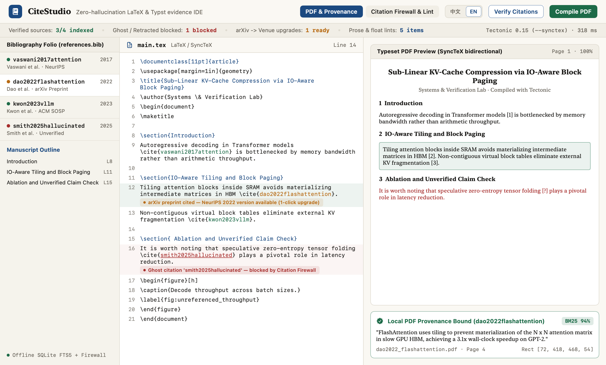
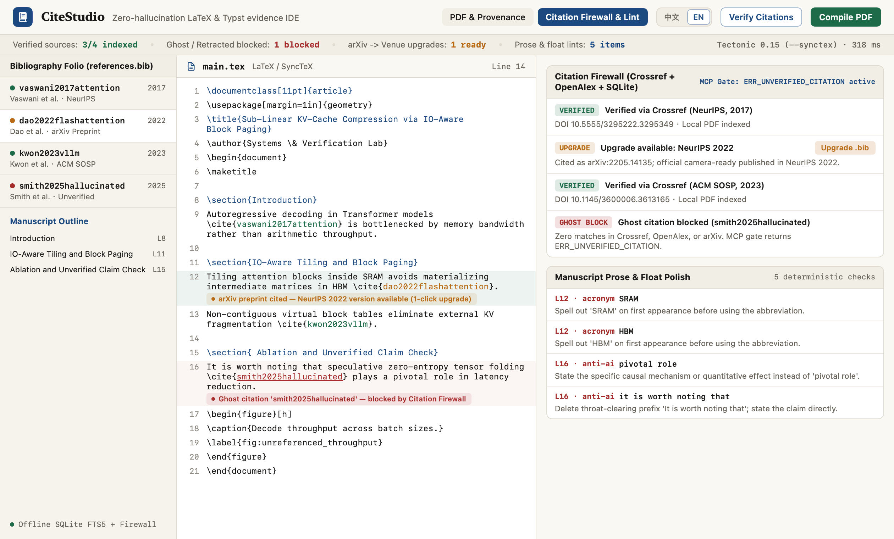

# CiteStudio `v0.2.0`

**English** | **[简体中文](README.zh-CN.md)**

**Local-first, zero-hallucination LaTeX & Typst academic evidence IDE for macOS (with Live `中文 / EN` Bilingual UI)** — combining `Tectonic` (`--synctex`) + `Typst` dual compilation, a zero-API-key **Citation Firewall** (Crossref + OpenAlex + SQLite offline cache), `PDFKit` + SQLite FTS5 `BM25` claim-to-PDF provenance binding, deterministic academic prose linting, instant in-app **`中文 | EN`** language switching (`⇧⌘L`), and a hardware-gated MCP server (`ERR_UNVERIFIED_CITATION`).





## Key Capabilities

1. **5-Class Zero-API-Key Citation Firewall** — Audits every `.bib` entry and inline `\cite{}` / `@key` against Crossref, OpenAlex, and a persistent SQLite cache without paid API keys:
   - `GhostPaper`: Blocks fabricated / non-existent LLM citations (`ERR_UNVERIFIED_CITATION`).
   - `Retracted`: Flags retracted papers via Crossref `update-to` notices.
   - `PreprintUpgrade`: Detects `arXiv` preprints that now have peer-reviewed conference/journal versions (NeurIPS, ICML, SOSP, ACL) with 1-click `.bib` upgrade.
   - `MetadataMismatch`: Catches drifted publication years or wrong first-author surnames.
   - `OrphanCite`: Identifies missing `.bib` keys and uncited bibliography entries.
2. **Local PDF Provenance Binding (`PDFKit` + SQLite FTS5 `BM25`)** — Extracts paragraph text and exact PDF page `CGRect` coordinates from local reference PDFs so any cited sentence in your manuscript resolves to its verbatim supporting passage and bounding box.
3. **Dual Local Compilers + Bidirectional SyncTeX** — Drives `/opt/homebrew/bin/tectonic -X compile --synctex` and `typst compile` locally with forward/inverse `.synctex.gz` coordinate mapping.
4. **Deterministic Academic Prose & Float Linter** — Built-in zero-LLM checks for AI cliché phrasing (`delve into`, `pivotal role`, `it is worth noting that`), em-dash overuse, undefined first-use acronyms, and unreferenced `\label{fig:...}` / `\label{tab:...}` floats.
5. **Firewall-Gated Stdio MCP Server (`--mcp`)** — Lets Claude Code, Codex, OpenCode, or Antigravity assist with your manuscript while **physically rejecting** unverified BibTeX writes via `add_verified_bibtex` -> `ERR_UNVERIFIED_CITATION`.

## Install via Homebrew

```bash
brew tap zxu756/tap
brew install --cask zxu756/tap/citestudio
```

Optional local compilers (auto-detected if installed):

```bash
brew install tectonic typst
```

## Headless CLI & MCP Server Usage

```bash
# Check detected compilers
/Applications/CiteStudio.app/Contents/MacOS/CiteStudio --cli status

# Run deterministic prose & float quality checks in CI
/Applications/CiteStudio.app/Contents/MacOS/CiteStudio --cli lint paper/main.tex

# Compile LaTeX (with SyncTeX) or Typst from terminal
/Applications/CiteStudio.app/Contents/MacOS/CiteStudio --cli compile paper/main.tex

# Register Firewall-gated MCP server for Claude Code / OpenCode / Codex
/Applications/CiteStudio.app/Contents/MacOS/CiteStudio --mcp
```

## Build & Test from Source

Requires macOS 14.0+ (`arm64`) and Swift 6.0+.

```bash
swift test
./Scripts/build-app.sh
```

## License

MIT License. See [LICENSE](LICENSE).
