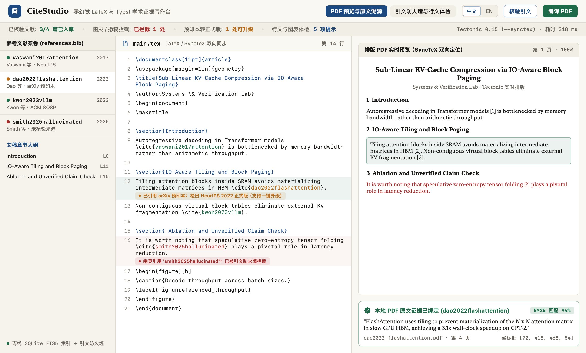
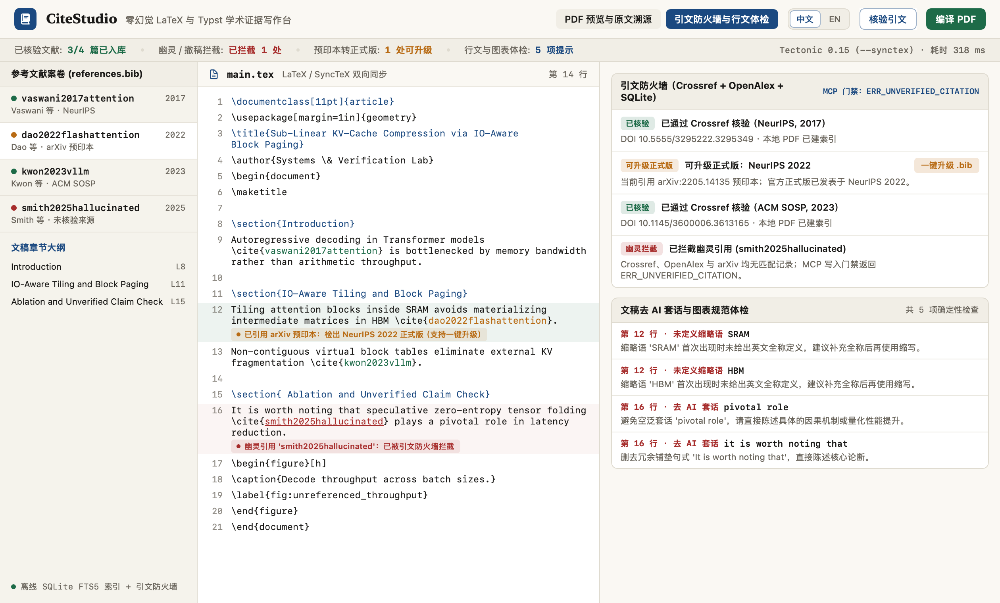

# CiteStudio `v0.2.0`

**[English](README.md)** | **简体中文**

**面向 macOS 的本地优先、零幻觉 LaTeX 与 Typst 学术证据写作台** —— 融合 `Tectonic`（`--synctex`）与 `Typst` 双引擎编译、零 API Key **引文防火墙**（Crossref + OpenAlex + SQLite 离线缓存）、`PDFKit` + SQLite FTS5 `BM25` 论断到原文 PDF 坐标级溯源绑定、确定性学术行文去 AI 套话体检，以及物理拦截虚假引用的 MCP 服务门禁（`ERR_UNVERIFIED_CITATION`）。`v0.2.0` 原生支持 **中文 / EN** 双语实时切换（顶栏 `中文 | EN` 胶囊按钮、快捷键 `⇧⌘L`、命令行 `--lang zh|en`，首次在中文 macOS 系统启动自动进入简体中文界面）。





## 核心能力

1. **五分类零 API Key 引文防火墙（Citation Firewall）** —— 无需任何付费密钥，结合 Crossref、OpenAlex 与本地持久化 SQLite 缓存逐条核验 `.bib` 条目与正文 `\cite{}` / `@key`：
   - `GhostPaper`（幽灵引用拦截）：识别并阻断大模型编造的虚构文献，MCP 接口直接返回 `ERR_UNVERIFIED_CITATION`。
   - `Retracted`（已撤稿文献告警）：基于 Crossref `update-to` 撤稿记录精准拦截已撤稿论文。
   - `PreprintUpgrade`（预印本转正式版）：自动检出已发表于 NeurIPS、ICML、SOSP、ACL 等顶会/期刊的 `arXiv` 预印本，支持一键升级 `.bib` 条目。
   - `MetadataMismatch`（元数据偏差）：捕获出版年份漂移或第一作者姓氏张冠李戴。
   - `OrphanCite`（孤立引用）：定位正文中缺失 `.bib` 定义的引用键以及 `.bib` 中从未被引用的冗余条目。
2. **本地 PDF 原文证据溯源绑定（`PDFKit` + SQLite FTS5 `BM25`）** —— 提取本地参考文献 PDF 的自然段文本与精确页面 `CGRect` 坐标框，将文稿中的每一条核心论断绑定回参考文献原文段落与页码区域。
3. **本地双编译引擎 + SyncTeX 双向定位** —— 原生驱动本机 `/opt/homebrew/bin/tectonic -X compile --synctex` 与 `typst compile`，支持 `.synctex.gz` 源码行号与 PDF 坐标双向映射。
4. **确定性学术行文去 AI 套话与图表规范体检** —— 内置零大模型幻觉的确定性规则，自动检测英文论文高频 AI 套话（`delve into`、`pivotal role`、`it is worth noting that` 等）、单句破折号（em-dash）过密、首次出现未定义的英文缩略语，以及正文未被引用的 `\label{fig:...}` / `\label{tab:...}` 孤立图表。
5. **带防火墙门禁的 Stdio MCP 服务（`--mcp`）** —— 允许 Claude Code、Codex、OpenCode 或 Antigravity 辅助撰写论文，同时在 `add_verified_bibtex` 写入 `.bib` 前执行物理级核验拦截（未核验文献一律返回 `ERR_UNVERIFIED_CITATION`，绝不污染参考文献库）。
6. **原生中英双语实时切换（`v0.2.0` 新增）** —— 牛津古籍羊皮纸（Oxford Archival Vellum）顶栏内置 `中文 | EN` 切换胶囊，支持 `⇧⌘L` 快捷键切换与 `UserDefaults` 语言记忆，中文排版零负字距、零省略号截断。

## 通过 Homebrew 安装

```bash
brew tap zxu756/tap
brew install --cask zxu756/tap/citestudio
```

可选本地排版编译器（安装后自动识别）：

```bash
brew install tectonic typst
```

## 命令行与 MCP 服务用法

```bash
# 查看已识别的本地编译器状态
/Applications/CiteStudio.app/Contents/MacOS/CiteStudio --cli status

# 在 CI 中运行确定性学术行文与图表引用体检
/Applications/CiteStudio.app/Contents/MacOS/CiteStudio --cli lint paper/main.tex

# 在终端编译 LaTeX（含 SyncTeX）或 Typst 文稿
/Applications/CiteStudio.app/Contents/MacOS/CiteStudio --cli compile paper/main.tex

# 导出 2x Retina 简体中文宣传截图
/Applications/CiteStudio.app/Contents/MacOS/CiteStudio --export-screenshots docs --lang zh

# 启动带引文防火墙门禁的 MCP 服务（供 Claude Code / OpenCode / Codex / Antigravity 接入）
/Applications/CiteStudio.app/Contents/MacOS/CiteStudio --mcp
```

## 从源码构建与测试

环境要求：macOS 14.0+（`arm64`）与 Swift 6.0+。

```bash
swift test
./Scripts/build-app.sh
```

## 开源协议

MIT License。详见 [LICENSE](LICENSE)。
